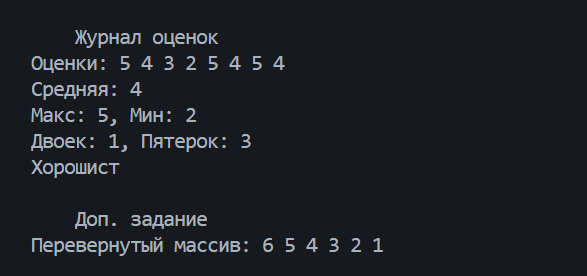
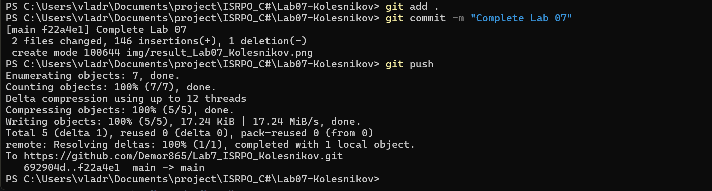

# Практическая работа №7

**ФИО:** Колесников Владислав Александрович  
**Группа:** ИСП-241

## Что изучено

- Индексация элементов в массиве начинается с нуля, а последний элемент всегда имеет индекс `Length - 1`.
- Цикл `foreach` удобно использовать, когда нужно просто прочитать все элементы массива по очереди. Если же нужно изменить элементы или знать их индекс, используется обычный цикл `for`.
- С помощью циклов и массивов можно легко решать типовые задачи: находить сумму, среднее арифметическое, минимум и максимум, не используя встроенные функции.

## Скриншоты

